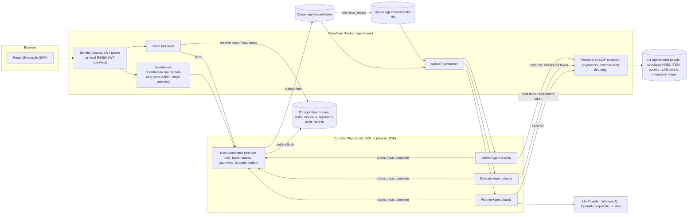

# AgentBoard

AgentBoard is an operations console for launching, monitoring and controlling agent runs that serve a **simulated** People-operations organization. A planning agent turns a request (an address change, an onboarding, an offboarding, a privileged grant) into a plan; an executor and a verifier carry it out through an MCP server; a per-run coordinator owns the shared task state, leases, budgets, approvals and a hash-chained audit trail. It is built on Cloudflare Workers with the Agents SDK, Durable Objects, Queues, D1 and MCP, with a React and TypeScript console.

**Everything People-related is simulated.** The HRIS, ITSM, access-management and notification systems are tables in a separate D1 database, filled with 60 fictional employees by a seeded generator. There are no real users, employees or HR systems behind it in any environment, production included.

**Production runs on Cloudflare's Workers Free plan; preview does not yet.** On 2026-10-15 the production environment was set up and deployed with `npm run cf:setup` and measured with `npm run cf:verify`: four synthetic runs through Cloudflare Access, each planned by Workers AI. Its numbers are under "Production" in Results, and every other number in this README was produced locally by this repository's own scripts. The preview environment and per-PR preview deployments have not been set up.

**Live demo.** [`docs/DEMO.md`](docs/DEMO.md) is the interview walkthrough of the production deployment: an operator's request, an approval and a rejection in a second window, talking points tied to the results files, and a local fallback.

The design is in [`SPEC.md`](SPEC.md), the domain terms in [`CONTEXT.md`](CONTEXT.md), the main decisions in [`docs/adr/`](docs/adr) (coordinator leases and queues, the integration ledger and call-bound tokens, policy-owned approvals with gating edges, derived run status with recovery cascades, measured results with a staleness check), and the milestone demo scripts in [`demos/`](demos).

## Architecture



How one run flows:

```mermaid
sequenceDiagram
  participant Op as Operator
  participant API as Hono API
  participant RC as RunCoordinator
  participant Q as Queue
  participant P as Planner
  participant E as Executor
  participant M as People Ops MCP
  participant V as Verifier
  participant Ap as Approver
  Op->>API: POST /api/runs (clientRequestId)
  API->>API: reserve (requester, clientRequestId) in D1
  API->>RC: initRun (idempotent)
  RC->>Q: dispatch plan task (outbox)
  Q->>P: claim lease, tools/list, plan with one repair
  P->>RC: completeTask(plan)
  RC->>RC: validate, apply approval policy, gating edges, materialize tasks
  RC->>Q: dispatch ready execute tasks
  Q->>E: claim lease, call-bound token
  E->>M: tools/call with idempotency key
  E->>RC: appendTrace, completeTask
  RC->>Q: dispatch verify task
  Q->>V: read tools, check the postcondition
  Note over RC: an approval-gated step waits; every later write depends on it
  Ap->>API: approve or reject
  API->>RC: resolveApproval (separation of duties, expiry)
  RC-->>Op: snapshot pushed over WebSocket after every commit
```

The rules that make it safe under at-least-once delivery:

- **One writer per run.** Agents never call each other; they claim, trace and complete only through the run's coordinator. Every coordinator RPC is one `transactionSync` that sweeps expired leases, approvals and deadlines, applies the operation, re-derives the run status, and writes rows, hash-chained audit events and outbox entries. Nothing inside it awaits.
- **Leases with fencing.** A claim is granted only for the task's current `dispatchId`; a redelivery of a live dispatch is refused `in_flight`, a superseded one `stale_dispatch`. Completions and traces carry the lease epoch, and one report per lease is accepted. The sweep, not a timer, reaps expired leases; the Agents SDK `schedule()` only wakes the coordinator.
- **Call-bound integration tokens.** After each lease grant the coordinator mints an HS256 token bound to that one call (tool, canonical arguments hash, idempotency key, run, task, step, epoch, lease expiry). The MCP endpoint and every tool handler check it.
- **An integration ledger.** Writes apply at most once per plan step, across retries and generations: ownership-guarded, correlation-guarded D1 batches, lock takeover, and logical replay of an earlier generation's result.
- **Only reads before an approval.** Gating edges make every other write depend on the approval-gated step's verification, so a rejection never leaves a write behind. `access.revoke_all_roles` has no approval of its own, so a plan may use it only together with the gated termination step (`hris.set_employment_status` to `terminated`), and it always waits for that approval. Rejection does not compensate steps that already ran; by construction only reads run before an approval gate.
- **Plans must do the work.** Besides the allowlist, subject pinning and gating rules, a plan must contain the writes its request type exists for (for example `hris.update_manager` for a manager change), so a read-only plan can never reach `succeeded` without making the change or asking for its approval.

## What runs where

| Capability | Local (this repo, offline) | Production or preview (after a Cloudflare login) |
|---|---|---|
| Worker, Hono API, static assets | workerd via `@cloudflare/vite-plugin` (`npm run dev`), `wrangler dev` on the built output (`npm run serve:built`, `eval:sim`), or Miniflare in vitest | Cloudflare Workers (Free plan) with static assets: `agentboard-production` on `nitish-ratakonda.workers.dev` (deployed 2026-10-15); `agentboard-preview` (not set up) |
| Agents (SQLite Durable Objects) | local SQLite Durable Objects | Durable Objects |
| Lease, approval and deadline wakes | Agent `schedule()` on Durable Object alarms (one-second granularity) plus the sweep on every RPC; tests use an injected clock | same code on Durable Object alarms |
| Queues and DLQ | local queues | Cloudflare Queues |
| D1 (console and simulated People systems) | local SQLite in `.wrangler/` | D1 |
| History search | D1 FTS5 | D1 FTS5 (same code) |
| Identity | `AUTH_MODE=dev`: RS256 JWTs from a locally generated key, verified by the same code as Access; dev login on loopback only | Cloudflare Access (Zero Trust Free, One-time PIN) JWT in `Cf-Access-Jwt-Assertion` against the team JWKS, audience from the `ACCESS_AUD` Worker secret (verified locally only against an intercepted JWKS); without the secret the Worker fails closed |
| LLM planning | deterministic stub in tests and the simulation; a local llama-server (Qwen3-1.7B Q4_0) for `eval:planner` | Workers AI `@cf/qwen/qwen3-30b-a3b-fp8` through AI Gateway, with Qwen3's thinking turned off by `/no_think` (unit-tested with a fake binding; in production, 4 verification runs on 2026-10-15) |
| MCP integrations | in-process Streamable HTTP to the simulated People systems; an external `/mcp` route for MCP Inspector only with `MCP_EXTERNAL=on` on loopback | the same in-process path to the same simulated systems; no external route (`MCP_EXTERNAL=on` is refused at load time) |
| Fault directives (simulation) | on in tests and the simulation | off, enforced at load time |
| Preview deployments | not applicable | `preview.yml` deploys each pull request from this repository to the shared `agentboard-preview` Worker once the `preview` GitHub environment's token and the `PREVIEW_DEPLOYS` variable exist; on GitHub its deploy job has been skipped every time, so nothing is deployed (the deploy was checked offline with `wrangler deploy --dry-run`) |
| Numbers in this README | all except the Production section | the Production section (`cf:verify`, 2026-10-15) and the production figures in "Cloudflare Free plan" |

## Local setup

Requires Node 24 or newer and no Cloudflare login. CI on GitHub Actions uses Node 24 from `.nvmrc`; every local run in this repository, including the measurements below, used Node 25.9.

1. `nvm use && npm ci`
2. `npm run dev:keys` writes `.dev.vars` with a local RS256 dev keypair, an integration signing key and `ACCESS_AUD=agentboard-dev` (gitignored). A checkout from before 2026-10-15 needs `npm run dev:keys -- --force`, or that line added, because `ACCESS_AUD` is no longer a var in `wrangler.jsonc`.
3. `npm run db:migrate:local && npm run db:seed:local`
4. `npm run dev`, open `http://127.0.0.1:5173/dev/login` and pick a seeded principal. Or run the built worker: `npm run serve:built -- --fresh`, then open `http://127.0.0.1:8784/dev/login`.
5. `npm test` and `npm run test:sim`.
6. Optional: `npm run llm:serve` in another terminal, then `npm run eval:planner`; and `npm run eval:sim`.

A bare `wrangler dev` is **unsupported**. Against `wrangler.jsonc` it fails, because the `assets` block has no `directory` (the Vite plugin supplies it at build time); after any `vite build` it would follow `.wrangler/deploy/config.json` to whatever `dist/` holds, which may be stale or a production build. `serve:built` and `eval:sim` build first, assert the built config is the local one, and pass `--config dist/agentboard/wrangler.json` with an absolute `--env-file`.

With the stub planner (the local default), only the synthetic dataset's requests can be planned; the launch form offers them as dev-only samples.

### Inspecting the MCP server (development only)

The agents reach the People Ops MCP server in-process; by default the worker answers 404 on `/mcp`. For debugging with MCP Inspector, add `MCP_EXTERNAL=on` to `.dev.vars` and restart `npm run dev` or `npm run serve:built` (the config loader refuses the flag outside development, and the route answers only on loopback hosts). Then mint a token:

```sh
npm run dev:token -- --integration --tool hris.get_employee --args '{"employeeId":"E-1001"}'
```

It is bound to that one read tool and those exact arguments for 60 seconds; write tools are refused. Connect MCP Inspector over Streamable HTTP through its local proxy (the route sends no CORS headers) to `http://127.0.0.1:8784/mcp` (`serve:built`) or `http://127.0.0.1:5173/mcp` (`npm run dev`), with the token as the bearer token. Checked with curl against the built worker (initialize, tools/list, the bound call, a refused call with other arguments, 401 without a token, 404 for a non-loopback host); MCP Inspector itself was not run here.

## Production setup (Workers Free plan; production done 2026-10-15, preview not yet)

Production was set up, deployed and verified with these scripts on 2026-10-15; the deployed version records the commit it was built from. Before that, the scripts were checked read-only against the account (`npm run cf:doctor` and `npm run cf:setup -- --dry-run`, which builds locally and runs `wrangler deploy --dry-run`). The preview environment has not been set up.

The target, all on the Free plan:

| Fact | Value |
|---|---|
| Cloudflare account | `dc93c3bc8aa4f9e09a0d7e7354a80873` (`account_id` in `wrangler.jsonc`) |
| Workers | `agentboard-production` and `agentboard-preview` on `https://<name>.nitish-ratakonda.workers.dev` |
| D1 | `agentboard`, `agentboard-people` (production); `agentboard-preview`, `agentboard-people-preview` (preview) |
| Queues | `agentboard-tasks` and `agentboard-tasks-dlq`; `agentboard-preview-tasks` and `agentboard-preview-tasks-dlq` |
| AI Gateway | `agentboard` (logs off, 30 calls a minute), Workers AI model `@cf/qwen/qwen3-30b-a3b-fp8` |
| Zero Trust | team domain `https://old-truth-a7dc.cloudflareaccess.com`; sign-in through the existing One-time PIN identity provider `743683e8-42d4-44e9-9991-ba57a1bb0dec` |
| Access | one self-hosted application per environment for its `workers.dev` hostname; reusable policies `agentboard-people` (Allow) and `agentboard-verify` (Service Auth); service tokens `agentboard-verify-operator` and `agentboard-verify-approver` |
| People who can sign in | `nitishsancs@gmail.com` (admin), `nitishsancs+ops@gmail.com` (operator), `nitishsancs+approver@gmail.com` (approver), `nitishsancs+viewer@gmail.com` (viewer) |

Every resource name starts with `agentboard`, and a unit test checks `wrangler.jsonc` against these facts.

Credentials:

- wrangler uses its OAuth login (`npx wrangler login`). Do not export `CLOUDFLARE_API_TOKEN`: the scripts remove it and every other credential variable from wrangler's environment, and `cf:setup` refuses to run unless `wrangler whoami` reports the OAuth login.
- `CF_API_TOKEN` is an account API token for what wrangler does not cover. Its permissions: Access: Apps and Policies Edit, Access: Service Tokens Edit, AI Gateway Edit, Account Analytics Read. wrangler itself still reads `CF_API_TOKEN` as a deprecated alias of `CLOUDFLARE_API_TOKEN`, which is why the scripts strip it before running wrangler.
- `cf:setup` writes the two service tokens' client secrets to `.secrets/cloudflare-service-tokens.json` (gitignored, mode 0600), where `cf:verify` reads them. No script prints a secret.

Commands, from a clean checkout of the commit to deploy:

```sh
npx wrangler login                                      # once; OAuth
npm run cf:doctor -- --env production                   # read-only: what exists and what is missing
CF_API_TOKEN=... npm run cf:setup -- --env production --dry-run   # read-only plan, local build, wrangler deploy --dry-run
CF_API_TOKEN=... npm run cf:setup -- --env production   # create, migrate, seed, deploy, Access, redeploy
CF_API_TOKEN=... npm run cf:verify -- --env production  # small simulation against the deployed Worker
npm run results:render                                  # then commit eval/results/production.json and README.md together
```

What `cf:setup` does, in order (each step checks first, so a second run changes nothing that is in place):

1. Creates the two D1 databases and the two queues if missing (queue retention is the Free plan's fixed 24 hours).
2. Creates AI Gateway `agentboard` with logs off (planner prompts carry request text, which the console hides from roles without `pii:read`) and a rate limit of 30 calls a minute.
3. Applies pending D1 migrations; seeds the 60 fictional employees only into an empty People database; inserts the planner, executor and verifier control rows if missing.
4. Creates the two verification service tokens (rotating one whose secret is not on this machine), and creates or updates the reusable policies: `agentboard-people` allows the four email addresses above, `agentboard-verify` (Service Auth) allows the two tokens.
5. Upserts the role bindings for the four people and the two service-token principals (`svc:<client id>`).
6. Builds with `CLOUDFLARE_ENV=<env>`, refuses any built configuration that is not that environment's, and deploys it tagged with the commit, with `INTEGRATION_SIGNING_KEY` generated once and sent as a secret through a 0600 temporary file. Until `ACCESS_AUD` exists the Worker fails closed: every route answers 500 `misconfigured`, and queue batches retry.
7. Creates the self-hosted Access application for the Worker's `workers.dev` hostname (allowed identity provider: One-time PIN only, chosen without a picker; both policies attached), then redeploys with its AUD tag as the `ACCESS_AUD` secret. The application is hostname-based because Worker-level Access refuses WebSocket upgrades, and the live run view is a WebSocket.
8. Checks that an unauthenticated request ends at the Access login.

Without `CF_API_TOKEN`, steps 2, 4 and 7 are skipped and the Worker stays fail-closed; running it again with the token finishes the job. The deploy is skipped when the deployed version is already this commit with both secrets (`--redeploy` forces it).

`cf:verify` checks that an unauthenticated request ends at the Access login and that each service token reaches `/api/me` with its role. It then launches four synthetic requests through the API (two address changes, a manager change it approves and a privileged grant it rejects, as the approver token, keeping separation of duties). Every run is planned by Workers AI, because a deployed Worker refuses every other planner. It waits for each run, cancels any run that needs attention or times out, and re-verifies every audit chain. It counts the runs' duplicate side effects in the integration ledger with a read-only `wrangler d1 execute` SELECT. It records every invocation's outcome and CPU time with `wrangler tail --format json`, and reads the GraphQL Analytics API: the Worker's CPU quantiles, Durable Object CPU time, today's Worker requests and D1 rows. It writes `eval/results/production.json` only for production and only when the deployed version is this checkout's committed code; otherwise it writes `eval/results/raw/`. Four runs cost at most 732 Workers AI neurons (6,000 planner tokens per run at most), out of the 10,000 a day this account's apps share.

A preview environment repeats this with `--env preview`. Cloudflare does not generate preview URLs for Workers that implement Durable Objects, so there is one shared preview Worker, `agentboard-preview`.

### Preview deployments from pull requests

`.github/workflows/preview.yml` deploys each pull request from this repository to `agentboard-preview` once these exist (none of them exist yet):

- GitHub environment `preview`, with **no required reviewer** and no branch restriction. It holds one secret, `CLOUDFLARE_API_TOKEN`.
- Repository variable `PREVIEW_DEPLOYS` = `on`.
- The preview resources, created once locally with `CF_API_TOKEN=... npm run cf:setup -- --env preview`.

`CLOUDFLARE_ACCOUNT_ID` is not needed, because `account_id` is in `wrangler.jsonc`. Without the variable the deploy job is skipped. Without the secret, its steps are skipped. Either way the workflow passes. Pull requests from forks never deploy.

Why no reviewer: the publish script merges a pull request only when `gh pr checks --watch` passes. A job waiting for an environment reviewer stays pending, so it would block every merge. The token is exposed only to code pushed to a branch of this repository by someone with write access, who could change the workflow itself anyway. It reaches only the `cf:setup --ci` step, never `npm ci` (dependency install scripts) or the build. In CI, `cf:setup --ci` creates nothing: it checks that the preview D1 databases, queues and both Worker secrets exist, applies pending migrations, refuses any build but the preview one, deploys, and checks that Access protects the URL.

The CI deploy token is an account API token scoped to account `dc93c3bc8aa4f9e09a0d7e7354a80873` with these permissions, derived from the calls `cf:setup --ci` and wrangler 4.149.0 make (not yet exercised with a real token):

| Permission | Why |
|---|---|
| Account: Workers Scripts Edit | upload the Worker, its static assets and its Durable Object migrations (part of the script upload; no separate permission), enable the `workers.dev` route, list secrets, read deployments and versions |
| Account: D1 Edit | list the databases, resolve them by name, apply migrations |
| Account: Queues Edit | check the queues exist and attach the queue consumers on deploy |
| Account: Account Settings Read | account-level reads wrangler makes during deploy (the "Edit Cloudflare Workers" template includes it) |

It needs no Access, AI Gateway, Workers AI or user-level permission: the Workers AI binding needs none at deploy time, and the workflow never runs `wrangler whoami`.

The top-level configuration is the local one and has `workers_dev: false`, so an accidental top-level deploy is unreachable; production and preview refuse dev auth, fault injection, the stub LLM, the OpenAI-compatible LLM provider (it would send planner prompts, which carry request text, to an unauthenticated endpoint) and a short signing key at load time. The console's pages and every `/api` response forbid framing (`public/_headers` for the static assets, `hono/secure-headers` for the API), so another site cannot frame the approval and recovery buttons.

## Cloudflare Free plan

Nitish chose the Workers Free plan (2026-10-10), so production and preview must work within it. Each limit below was read on developers.cloudflare.com on 2026-10-15. The usage column comes from the code, from counts in the local simulation's state (100 runs, `eval:sim`), and from the first production verification on 2026-10-15 (`npm run cf:verify`, 4 runs; the GraphQL Analytics API figures are in `eval/results/production.json`).

| Feature | Free limit | Source | This app's usage | Verdict |
|---|---|---|---|---|
| CPU time per HTTP request | 10 ms ("some built-in flexibility" for infrequent overruns) | [Workers limits](https://developers.cloudflare.com/workers/platform/limits/) | API requests: an RS256 Access JWT check (WebCrypto, JWKS cached per isolate), Zod validation, a few D1 queries or one Durable Object call; static assets skip the Worker except `/api/*`, `/agents/*` and `/mcp`. Production, 2026-10-15 (Analytics API, the verification's window): 92 requests, CPU p50 4.8 ms and p99 40.6 ms, all 92 successful (none stopped) | p50 fits; p99 is over 10 ms and was tolerated; watch it as traffic grows |
| CPU time in Durable Objects | 30 s per request (no Free-specific figure) | [Durable Objects limits](https://developers.cloudflare.com/durable-objects/platform/limits/) | coordinator transactions, planning (the model call is I/O), MCP tool calls | fits |
| Subrequests per invocation | 50 (fetch and Cloudflare services such as D1); 1,000 to internal services | [Workers limits](https://developers.cloudflare.com/workers/platform/limits/) | one coordinator outbox flush: at most 16 binding calls (8 rounds per lane, changed for Free); a queue consumer batch of 5 (changed for Free): about 2 calls per task message, at most 4 per dead letter; MCP calls stay in-process (no subrequest); a planner task: at most 2 Workers AI calls | fits |
| D1 queries per invocation | 50 ("read subrequest limits") | [D1 limits](https://developers.cloudflare.com/d1/platform/limits/) | each outbox round is one `batch()` (the page does not say how batched statements count) | fits; a limit hit would show in `cf:verify`'s limit outcomes |
| Worker requests per day | 100,000, reset 00:00 UTC; then error 1027 | [Workers limits](https://developers.cloudflare.com/workers/platform/limits/) | static assets are free and unlimited ([pricing](https://developers.cloudflare.com/workers/platform/pricing/)); the console's API calls; the live run view is one WebSocket. Production on 2026-10-15: 172 requests to `agentboard-production` that UTC day up to the end of the verification, setup and an earlier, failed verification included | fits |
| Memory; Worker size; startup | 128 MB per isolate; 64 MiB uncompressed; 1 s startup | [Workers limits](https://developers.cloudflare.com/workers/platform/limits/) | production upload 2,861 KiB (637 KiB gzip) per `wrangler deploy --dry-run` | fits (startup time not measured) |
| Workers per account | 100 | [Workers limits](https://developers.cloudflare.com/workers/platform/limits/) | 2 | fits |
| Durable Objects storage backend | SQLite-backed only | [Durable Objects limits](https://developers.cloudflare.com/durable-objects/platform/limits/) | all four classes are `new_sqlite_classes` (the Agents SDK needs SQLite) | fits |
| Durable Object requests per day | 100,000 (HTTP, RPC sessions, WebSocket messages at 20:1, alarms); further operations fail | [Durable Objects pricing](https://developers.cloudflare.com/durable-objects/platform/pricing/) | per task: the role-agent call plus its claim, trace and complete calls to the coordinator, plus scheduled wakes | fits for a demo (not measured) |
| Durable Object SQLite rows written; read; storage | 100,000; 5 million a day; 5 GB | [Durable Objects pricing](https://developers.cloudflare.com/durable-objects/platform/pricing/) | the coordinator inserted 83 rows per run in the simulation (32 audit events, 28 outbox rows, 7 tasks, 7 reports, 6 traces), before updates | the first daily limit likely to bind, at a few hundred runs a day |
| Queues operations per day | 10,000 (a write, read or delete per 64 KB; a retry is a read) | [Queues pricing](https://developers.cloudflare.com/queues/platform/pricing/) | 6.8 task messages per run in the simulation, so about 20 operations per run | fits for a demo (a few hundred runs a day) |
| Queue retention; queues per account | 24 hours, not configurable; 10,000 | [Queues limits](https://developers.cloudflare.com/queues/platform/limits/) | queues are created without a retention flag; messages are consumed within seconds and retries back off at most 300 s; 4 queues | fits (changed for Free: no retention flag) |
| D1 databases; size; storage | 10 per account; 500 MB each; 5 GB | [D1 limits](https://developers.cloudflare.com/d1/platform/limits/) | 4 (2 per environment); the account had none on 2026-10-15, and the other apps planned for it will add theirs | fits; watch the 10-database cap across apps |
| D1 rows read; written per day | 5 million; 100,000 (account-wide), then queries fail until 00:00 UTC | [D1 pricing](https://developers.cloudflare.com/d1/platform/pricing/) | the console database held 75 rows per run after the simulation (32 audit events, 14 search documents plus their FTS rows, 7 tasks, 6 tool calls), before mirror updates. Production on 2026-10-15, that UTC day up to the end of the verification, setup, the seed and an earlier, failed verification included: `agentboard` wrote 2,697 rows and read 3,391, `agentboard-people` wrote 808 and read 334; with two other apps' databases the account wrote 18,693 rows of its 100,000 | fits for a demo; shared with the other apps |
| Workers AI | 10,000 neurons a day; further calls fail | [Workers AI pricing](https://developers.cloudflare.com/workers-ai/platform/pricing/) | `@cf/qwen/qwen3-30b-a3b-fp8` costs 4,625 neurons per million input tokens and 30,475 per million output tokens; a run may spend 6,000 planner tokens (default budget), at most 183 neurons. The production verification's 4 runs spent 3,577 planner tokens, 17 to 109 neurons | fits; shared with three other apps on the account |
| Workers Logs | 200,000 events a day, 3 days retention | [Workers Logs](https://developers.cloudflare.com/workers/observability/logs/workers-logs/) | `observability` on, one event per invocation plus logs | fits |
| Access seats | one seat per user who authenticates; service tokens take none | [Seat management](https://developers.cloudflare.com/cloudflare-one/team-and-resources/users/seat-management/) | 4 people (owner and 3 plus-address personas) and 2 service tokens (of 50 per account), 2 applications and 2 reusable policies (of 500 each, [account limits](https://developers.cloudflare.com/cloudflare-one/account-limits/)) | fits. The Free plan's cap of 50 users appears on cloudflare.com's pricing pages, not on developers.cloudflare.com |
| Access on `workers.dev` | a self-hosted application for the hostname; Worker-level Access refuses WebSocket upgrades | [Workers and Access](https://developers.cloudflare.com/workers/configuration/cloudflare-access/) | hostname-based applications, so the live run WebSocket works | fits |

What changed for the Free plan: one outbox flush makes at most 16 binding calls (it could make up to 100 while draining a backlog); deployed queue consumers take batches of 5 instead of 10; queues are created without a retention flag. Nothing else needed Workers Paid: no `limits` block, no Cron Triggers, no Smart Placement, no Logpush.

## Tests

- `npm test` runs five projects: `worker` (workerd), `worker-ws` (WebSockets, isolation off as the Cloudflare known-issues page requires), `worker-access` (production Access verification against an intercepted JWKS), `web` (React components in happy-dom) and `node` (script math and launchers).
- `npm run test:sim` drives all 100 synthetic requests through the real API, queue, coordinator, agents and MCP tools in workerd, with the same driver as `eval:sim`.
- 109 tests are tagged `orchestration` or `authz`: the 100 planned in SPEC section 13.1, plus 4 added with the fixes of an independent review (`plan-guard.test.ts` #2, `planner.test.ts` #5 and #6, `websocket-auth.test.ts` #5), 2 added with later fixes (`planner.test.ts` #7, planner tasks sharing a catalog read in flight; `websocket-auth.test.ts` #6, WebSocket reauthorization), 2 added with the fixes of a second review (`state-machine.test.ts` "verify and plan recovery ..."; `executor.test.ts` "journal fast path ...") and 1 added for the Free plan (`outbox-audit.test.ts` "one flush makes at most OUTBOX_ROUNDS_PER_FLUSH D1 calls ..."). `npm run count:tests` counts them with `vitest list --tags-filter` and runs them for pass counts; CI checks the README against the count. The other tests (search, MCP tools and the dev-only `/mcp` route, LLM providers, the data generator, 18 React tests of components and the dev login page, eval math and results provenance, the deploy tooling, launchers and the toolchain gate) carry their own tags and are not part of that count.
- `.github/workflows/ci.yml` runs on every branch push and pull request: `types:check`, `typecheck`, `synth:check`, `npm test`, `test:sim`, `count:tests -- --check`, `results:check` and `build`, then prints the worker bundle size. Its record on GitHub is under "History, pull requests and authorship" below. `preview.yml` and `release.yml` are described under "Preview deployments from pull requests" and Releases.

## Releases

Four milestone tags, `v0.1.0` to `v0.4.0`, exist with a demo script each in `demos/` and a section each in `CHANGELOG.md`. No GitHub release has been published yet. `.github/workflows/release.yml` publishes one. Pushing a `v*` tag runs the full CI workflow on the tagged commit, then creates the release with the tag's changelog section and its demo script as notes. An existing release is left untouched.

The four existing tags predate the workflow (GitHub runs the workflow file of the tagged commit), so their releases are created by running it by hand from `main`. That reads the notes from `main`'s `CHANGELOG.md` and does not run CI:

```sh
gh workflow run release.yml --repo nitishsjsucs/agentboard --ref main -f tag=v0.1.0
gh workflow run release.yml --repo nitishsjsucs/agentboard --ref main -f tag=v0.2.0
gh workflow run release.yml --repo nitishsjsucs/agentboard --ref main -f tag=v0.3.0
gh workflow run release.yml --repo nitishsjsucs/agentboard --ref main -f tag=v0.4.0
gh run list --repo nitishsjsucs/agentboard --workflow release.yml --limit 4   # each should end in success
gh release list --repo nitishsjsucs/agentboard
```

The notes step was run locally for all four tags. Each produced the changelog section's title ("v0.1.0: Foundations" and so on), its bullets, and the demo script under "Demo script".

The tags' own CI (from pushing them) passed for `v0.1.0` to `v0.3.0` and failed for `v0.4.0` at `results:check`. Every step before it passed (types, typecheck, synthetic data, tests, the simulation, the test count); the build did not run. The tagged result files cite the working repository's commit id, which the published history does not contain. Re-running that CI as is fails again, because the tag's own scripts and result files are unchanged (reproduced on a clone of the published history). The tag stays where it is. Its release can be published by hand as above, and its changelog section now carries a note saying so. The `results:check` in later commits finds the measured commit by author date and measured content, so a new tag cut after this round passes on the published history (checked on a simulated copy, see `PROGRESS.md`). The next milestone tag is `v0.5.0`. Before tagging, rename the CHANGELOG's "Unreleased" heading to `## v0.5.0: <title>`, because the release workflow refuses a tag without a changelog section.

## History, pull requests and authorship

How it is built: the code, tests and docs were written with Claude Code (an AI coding agent) from `SPEC.md`, in rounds. `PROGRESS.md` records each round, its deviations from the spec and the review findings. The reviews were AI reviews run by the same tooling; no human has reviewed the code. The deployment is operated the same way: Claude Code ran `cf:setup` and `cf:verify` for production on 2026-10-15, found the Qwen3 thinking problem described under Limitations, and committed the fix.

How it reaches GitHub: the builders commit to a separate working repository and never push. A publish script copies each new commit into the GitHub repository as a new commit (same tree, author and dates, message without any `Co-Authored-By: Claude` trailer). It rewrites the commit ids cited in files to the published ones, and lands each increment as a pull request that it opens and merges itself with a merge commit. From 2026-10-15 the script merges a pull request only after its CI checks pass and leaves a red one open. Earlier pull requests were merged without waiting. In the working repository, every commit up to `b59f22c` except one (a README commit made by a parallel session, see `CHANGELOG.md`) carries a `Co-Authored-By: Claude` trailer; later commits carry none. No commit on GitHub carries one.

State of the GitHub repository on 2026-10-15 (read with `gh`; later increments add to it):

- The first 8 commits were pushed straight to `main`. After that, pull requests #1 to #11 were each opened and merged by the publish script within seconds, without review and before their CI had finished. #7 holds only a commit the publish script made itself, which points measured-commit references at the published history.
- `ci.yml` ran 38 times and failed 16 times. `main` was red after merging #3 to #6, whose result files cited working-repository commit ids that the published history did not contain (the publish script did not rewrite them at the time). It was also red after #8, which ended between three fixes and their re-measurement. It was green after #1, #2, #7 and #9 to #11.
- `preview.yml` ran 9 times; its deploy job was skipped every time (no Cloudflare secrets), so GitHub records no deployment and the repository has no `preview` environment. (Production on Cloudflare was deployed from the working repository with `cf:setup`, not by a workflow.)
- The tags `v0.1.0` to `v0.4.0` are there (CI as described under Releases); no GitHub release exists.

## Results

Every number below is written by a script into `eval/results/*.json` and rendered here by `npm run results:render`. CI (`npm run results:check`) fails if this block differs from the JSON, if a measurement ran on a dirty tree, or if anything under `src`, `migrations`, `fixtures`, `scripts`, `test` or `seed`, or `wrangler.jsonc`, `package.json`, `package-lock.json`, `vite.config.ts` or `vitest.config.ts`, changed after the measured commit. Measurement dates are UTC.

<!-- RESULTS:START -->

### Simulation (100 synthetic runs, local)

Command: `npm run eval:sim` (wrangler dev on the built worker: local workerd, local D1, local queues; stub planner). Measured 2026-10-15 at commit `0dbe380`.

| Metric | Value |
|---|---|
| Runs executed | 100 |
| Injected by the seeded dataset: fault directives; checkpoint runs the driver pauses or cancels | transient_error 18 (3 of them twice), duplicate_delivery 10, crash_after_call 6, permanent_error 4, silent_noop 4, budget_exhausted 3; pause_resume 3, cancel 2 |
| Outcome distribution | awaiting_approval 3, cancelled 4, rejected 6, succeeded 87 |
| Outcome match (measured status equals expected) | 100/100 |
| Duplicate side effects (per idempotency key) | 0 |
| Logical duplicate side effects (per run and step) | 0 |
| Duplicate; missing rows in the simulated domain tables (tickets, notifications, new grants) against applied steps | 0; 0 |
| Tool calls | 573 (ok 542, permanent_error 4, replayed 6, retryable_error 21) |
| Ledger replays (of which logical) | 6 (0) |
| Task retries; runs recovered by retry | 21; 18 |
| Lease expiries; recovered | 6; 6 |
| Refused duplicate or stale deliveries | 10 |
| Approvals requested; approved, rejected, pending | 45; 36, 6, 3 |
| Budget exhaustions; recoveries | 3; 3 |
| Silent no-ops detected by the verifier; false positives | 4/4; 0 |
| Recovery actions | approval.decided 42, budget.raised 3, run.cancelled 4, run.paused 3, run.resumed 3, task.retried 8, task.skipped 4 |
| Audit events; runs with a valid hash chain | 3228; 100/100 |
| Search known-item smoke check (20 queries) at 1; at 5 | 20/20; 20/20 |
| Run duration p50; p95 (local wall clock) | 7261 ms; 10921 ms |
| Search latency p50; p95 (local) | 2 ms; 3 ms |

This distribution is fixed by the dataset design; outcome match is the measured agreement. It is not a success rate. Every failure above is injected by the dataset's fault directives, and every approval decision and recovery command is issued by the simulation driver acting as an operator, so the table measures how the system responds to those injected faults. The known-item search check is a smoke test of indexing and ranking (each query is unique by construction), not a retrieval-quality benchmark.

### Planner (local model)

Command: `npm run eval:planner` against llama-server (b11146-7fe450e19) serving `Qwen3-1.7B-Q4_0-rtn.gguf` (Q4_0), launched with `-np 1 -c 8192 -ngl 99 --reasoning off --jinja` (model file, 8192-token context and single slot read back from the server), temperature 0, seed 7, one request at a time. Measured 2026-10-15 at commit `0dbe380`.

| Metric | Value |
|---|---|
| Valid plans, first pass | 57/100 (57%) |
| Valid plans after one repair | 77/100 (77%) |
| Valid plans that contain every write of the gold plan | 76/100 (76%) |
| Invalid after the repair; requests that failed at the transport (timeout or connection) | 23; 0 |
| Plans rejected for policy violations | 0 |
| Tool sequence exactly equal to gold | 34/100 (34%) |
| Tool-set F1 (macro) | 0.932 |
| Argument accuracy (gold fields of matched steps) | 0.982 |
| Unknown-tool rate (0 by construction: the output schema enumerates the allowed tools) | 0.000 |
| Latency p50; p95 | 3841 ms; 10565 ms |
| Prompt tokens p50; max | 905; 1357 |

### Tests

Command: `npm run count:tests`. Measured 2026-10-15 at commit `0dbe380`.

Tagged tests: 67 orchestration + 42 authorization = 109; passing: 109.

### Production (Workers Free plan)

Command: `npm run cf:verify -- --env production` against https://agentboard-production.nitish-ratakonda.workers.dev through Cloudflare Access with two service tokens; every run planned by Workers AI (`@cf/qwen/qwen3-30b-a3b-fp8`). Measured 2026-10-15 at commit `c9130b5`, deployed version `9b2bf0aa-0025-41e7-867d-9874f7e3a98c`. These numbers describe the code of that commit as deployed; `results:check` does not require later code to match them, because measuring again needs a deploy.

| Metric | Value |
|---|---|
| Runs | 4 |
| Outcome distribution | rejected 1, succeeded 3 |
| Outcome match (measured status equals the dataset's expected status) | 4/4 |
| Runs the verifier cancelled (needs attention or timed out) | 0 |
| Runs with a valid audit hash chain | 4/4 |
| Duplicate side effects per idempotency key; per run and step | 0; 0 (6 ledger rows) |
| Tool calls | 14 |
| Planner tokens; Workers AI neurons (bounds) | 3577; 17 to 109 |
| Unauthenticated request | 302 to the Access login: Access protects the hostname |
| HTTP 5xx responses | 0 |
| Invocations that exceeded a CPU or memory limit (wrangler tail) | not observed (wrangler tail delivered no events) |
| Worker fetch invocations (Free plan limit: 10 ms CPU) | not observed |
| Worker queue invocations | not observed |
| Worker CPU per request from the Analytics API, this run's window (Free plan limit: 10 ms; requests over it were not stopped) | 92 requests (success 92); p50 4.8 ms, p99 40.6 ms |
| Run duration p50; p95 (production wall clock) | 46939 ms; 88291 ms |

<!-- RESULTS:END -->

Reading the results:

- The simulation uses the deterministic stub planner, so it measures orchestration (leases, retries, replays, approvals, budgets, recovery, audit, search indexing), not planning quality.
- Each planner shard reads the tool catalog (`tools/list`, recorded as a tool call with its own audit event) once per 5-minute cache lifetime, and planner tasks that reach the shard while that read is in flight wait for it. The simulation finishes well within 5 minutes, so the tool-call and audit-event totals include exactly one catalog read per shard (2; checked in the eval's local D1). Up to commit `52d601a` concurrent tasks could each read the catalog before the cache was filled, so those totals varied by a few between runs (575 and 577 tool calls); the 2 fewer tool calls and audit events come from that change alone. The measurements at `b3f5ed8` (the first after it), `83fb6fb`, `6541d6e`, `b362e3e` and `0dbe380` all counted 573 tool calls and 3228 audit events.
- Local latencies move between runs of the same code and with the load on the machine. The results above were measured at `0dbe380` on 2026-10-15 in the working tree, on a laptop on AC power with a light load. Every count, outcome and planner quality metric matched the two previous measurements, including all 100 per-request planner results:
  - at `b362e3e` (commit `82b324e`), taken the same day while three other repositories' test suites loaded the Mac (load averages from 15 to over 100), only latencies differed: planner p50 4745 ms and p95 15284 ms, simulation run duration p50 10334 ms and p95 15957 ms, search p50 18 ms and p95 25 ms;
  - at `6541d6e` (commit `d7811c7`), likewise: planner p50 3141 ms and p95 8530 ms, run duration p50 7296 ms and p95 10884 ms, search p50 2 ms and p95 5 ms.

  That measurement had matched the one at `83fb6fb` (commit `ab705c7`) in every count and every per-request planner result. That one matched the measurement at `b3f5ed8` (commit `baf61df`); that one the measurement at `52d601a` (commit `f3da1c3`) in every count except the 2 catalog reads described above; and that one the measurement at `b7db936` (commit `c499cfb`) in every count.
- Every failure in the simulation is injected by dev-only fault directives at fixed counts from the seeded dataset (the "Injected" row), and every approval decision and recovery command is issued by the simulation driver acting as an operator. The retry, lease-expiry, refusal, budget, verifier and recovery rows measure how the system responds to those injected faults; none of them is an organic failure.
- The two duplicate side-effect rows come from the integration's own ledger table (`side_effects`), whose insert carries the same guard as the effects. The domain-table row is the independent check: the rows in the simulated tickets, notifications and grants tables, compared with the distinct (run, step) pairs that have an applied call of that tool in the console's tool-call history. In-place updates (addresses, managers, statuses, revocations) are idempotent by nature, so a duplicate of one would not show up in state.
- Some safety paths never fire in the simulation by design: no scenario re-runs a write that really applied, so logical replays stay at zero there, and no infrastructure failure exhausts queue retries, so the DLQ stays empty. The executor journal never answers either: with the default 2 shards the shard hash always sends a lease-expiry redispatch (attempt + 1) to the other shard (`queue/sharding.ts` says why), so all 6 crashes after a call are recovered by ledger replays. These paths are covered by tests (`idempotency.test.ts` "the idempotency key is stable across attempts and changes with generation ...", in `retries.test.ts` "the DLQ consumer ... dead-letters a task only for its current dispatchId ..." and "DLQ replay redispatches ...", and `executor.test.ts` "journal fast path ...").
- A valid plan passes the schema, the request type's allowlist, subject pinning, the gating rules, the request type's required writes and the rule that `access.revoke_all_roles` needs the gated termination step. "Valid with every write of the gold plan" also requires the notification and every other write the gold plan has. The required-writes rule is new: before it (results measured at `cf21c23`), 84/100 plans were valid but 66 of those were a single read step that would have reached `succeeded` without doing the work. The planner prompt now also names the required writes, so the jump in quality since then comes from both the rule (with its repair message) and the prompt.
- The output schema enumerates the request type's allowed tools and llama-server enforces it, so the unknown-tool rate and off-allowlist rejections are 0 by construction. Only off-subject arguments and ungated revokes can be rejected as policy violations here, and the dataset contains no injected requests; `plan-guard.test.ts` covers injection.
- Planner argument accuracy is computed only over gold steps the model got right by tool and position. Read it together with exact match and tool-set F1, which show how far the plans are from the gold sequences.
- Planning quality of the production model (Workers AI) is not measured: the production verification runs only four requests, to check the deployment, and they matched their expected outcomes only after Qwen3's thinking was turned off (see Limitations).

## Limitations and claim boundaries

- The People organization, its systems and its employees are simulated. Nothing here has served real users.
- Only the planner calls a model. The executor and verifier are deterministic Agents SDK Durable Objects by design.
- The 100-run simulation uses the stub planner; planning quality is measured separately by `eval:planner` against a small local model. In production, Workers AI has planned only the verification's runs.
- Qwen3 on Workers AI thinks before it answers, and the thinking counts against `max_tokens`. In the first production verification on 2026-10-15, `@cf/qwen/qwen3-30b-a3b-fp8` spent all 800 planner output tokens on reasoning and returned no content (`finish_reason: length`), so 2 of 4 planner tasks failed on every attempt. The Workers AI provider now appends Qwen3's `/no_think` switch to the user turn. Checked against the REST API, that gave `finish_reason: stop` and valid JSON in about 310 tokens, while `chat_template_kwargs.enable_thinking: false` did not turn reasoning off. The provider names an output budget spent on reasoning as such, and each agent exception's message is logged to Workers Logs. The verification after the fix matched 4/4. The local planner eval is unaffected: it runs llama-server with `--reasoning off` through the OpenAI-compatible provider.
- `wrangler tail` delivered no events during the production verification, so per-invocation CPU and limit outcomes were not observed. The Worker's CPU comes from the GraphQL Analytics API instead (p50 4.8 ms and p99 40.6 ms over 92 requests, none stopped). Durable Object CPU appears there only as raw per-namespace sums.
- The Workers Free plan's daily allowances (Worker and Durable Object requests, Durable Object and D1 rows, 10,000 queue operations, 10,000 Workers AI neurons shared with three other apps) bound the deployment to a demo of a few hundred runs a day; past one of them, operations of that kind fail until 00:00 UTC. See "Cloudflare Free plan".
- Every class runs in one Worker that holds the integration signing key, so call-bound tokens defend against confused or buggy call paths (wrong tool, tampered arguments, replay into another task or after the lease), not against arbitrary code running inside the Worker.
- Rejection does not compensate steps that already ran; by construction only reads run before an approval gate.
- A run WebSocket is authorized at the upgrade, which checks the identity token and the principal's role binding, and must be authorized again 5 minutes later: before the first snapshot after that time the coordinator closes it normally, and the client reconnects through the same checks. Once the token has expired the socket is closed with code 4401 instead, and the client stops. So a removed or downgraded role binding reaches an open socket at its first snapshot after at most 5 minutes; every HTTP request re-checks the binding.
- `npm audit` reports one high-severity advisory, GHSA-6qxp-vccf-f47h, for the pinned MCP SDK packages (`@modelcontextprotocol/client` 2.0.0 and `@modelcontextprotocol/sdk` 1.30.0, also reached through `agents`): the SDK's OAuth client could send credentials to an authorization server chosen by the MCP server. The fixed versions are client 2.2.0 and sdk 1.31.0. They are not installed because `agents` 0.27.0, the version SPEC section 2.2 pins, declares exact peers `@modelcontextprotocol/sdk` 1.30.0 and `@modelcontextprotocol/client` 2.0.0. `npm audit`'s only fix is `agents` 0.28.1, a semver-major change that re-pins all three MCP packages (checked 2026-10-15). The vulnerable flow cannot run here, for three reasons. AgentBoard's only MCP client passes a minimal `authProvider: { token }`, which the SDK's `isOAuthClientProvider` does not treat as an OAuth provider (that needs `tokens()` and `clientInformation()`). Its `fetch` calls the in-process People Ops endpoint, so no request leaves the Worker. And the Agents SDK's OAuth callback handler is never reached: no code calls `addMcpServer`, and the agent route answers 404 to every non-WebSocket request before it reaches an agent.
- Local latencies come from `wrangler dev` on a laptop and say nothing about production.
- D1 export does not support FTS5 virtual tables: to back up, drop `search_fts`, export, recreate it, then rebuild with `INSERT INTO search_fts(search_fts) VALUES('rebuild')`.

## License

MIT
