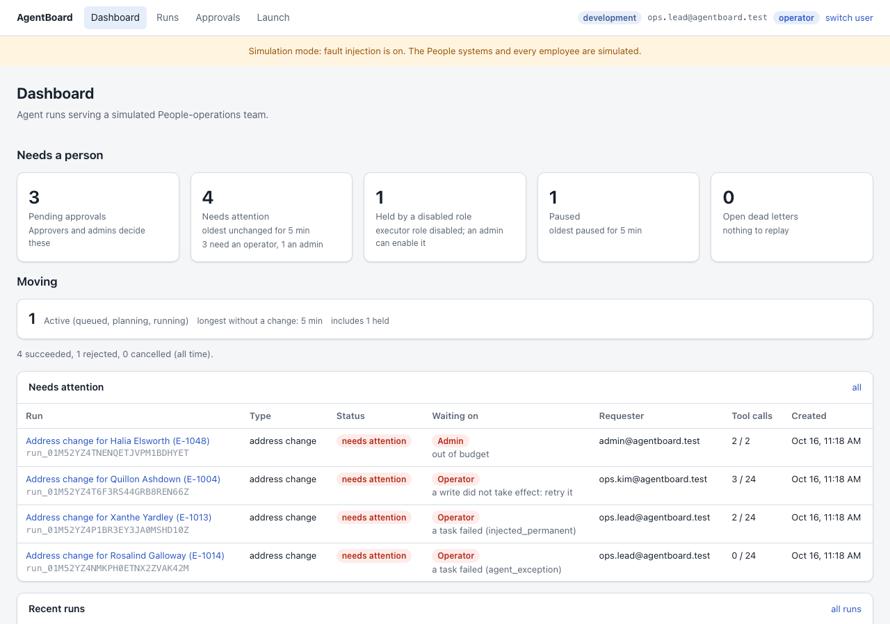
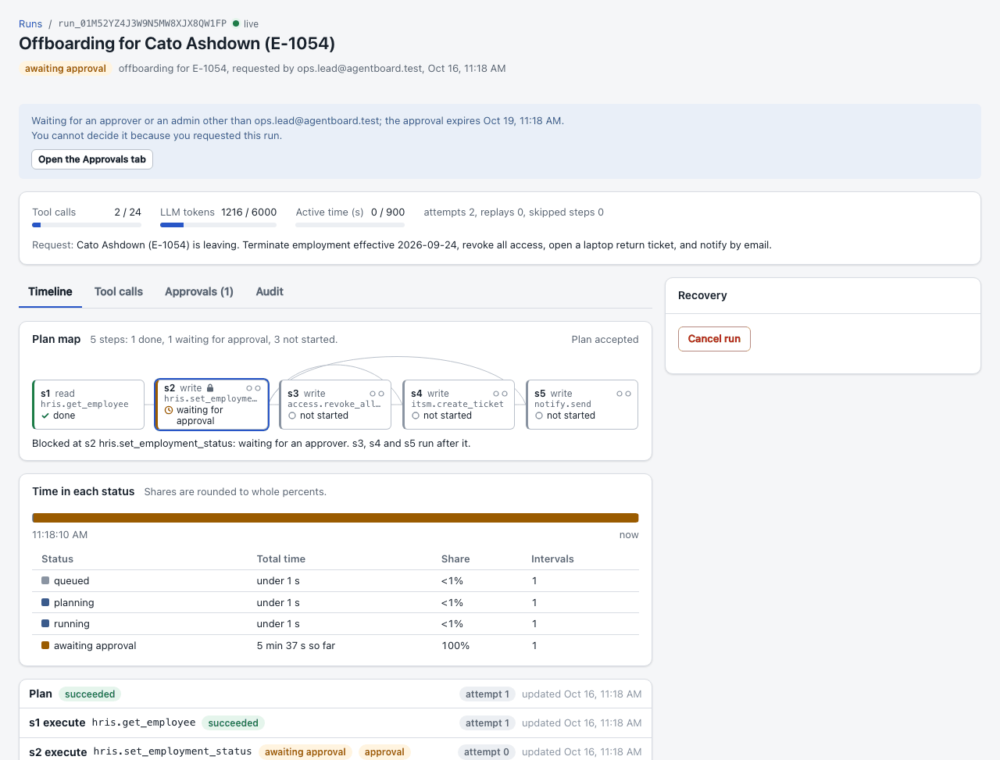
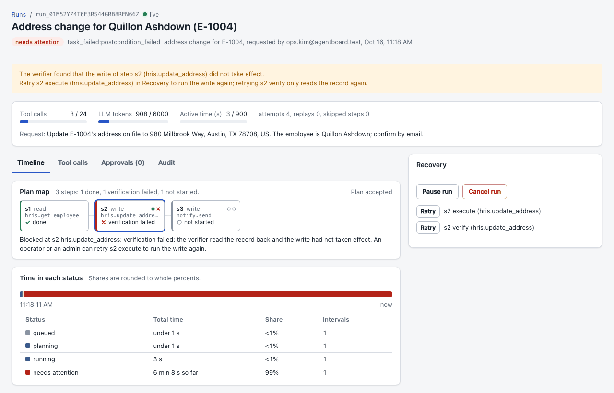
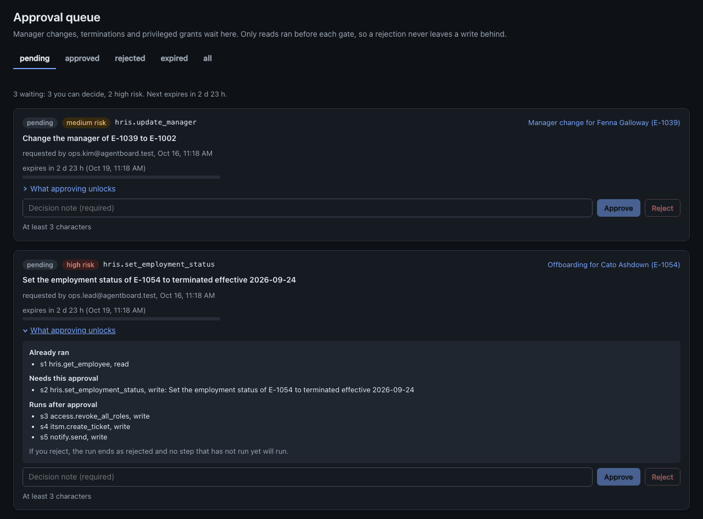
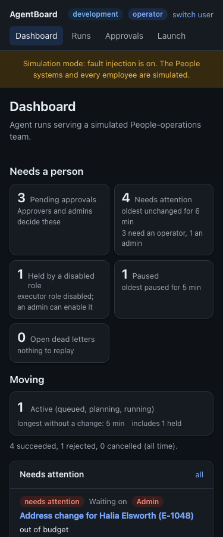
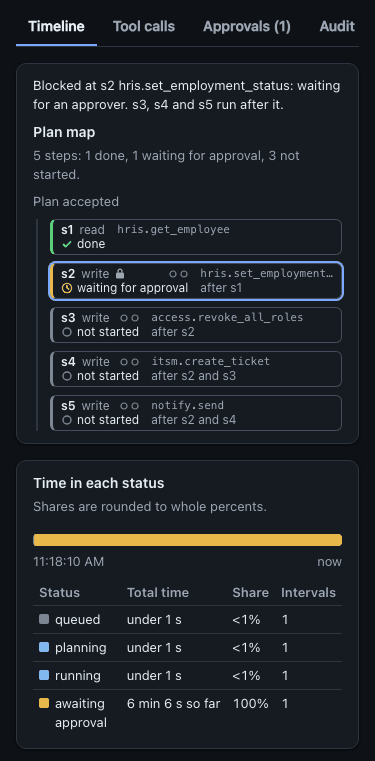
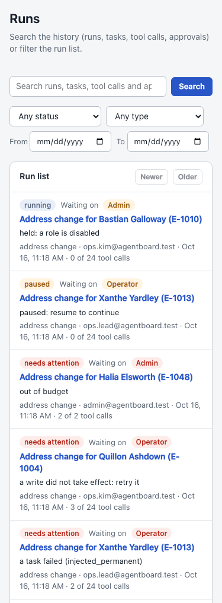

# User workflows

How each kind of user moves through the AgentBoard console, as the code in this repository works now. Labels in quotes are the console's own text from `src/web`. The production deployment was built from commit `c9130b5` and does not have the changes listed under "Changed on 2026-10-15", "Fixed after review (2026-10-15)" and "Changed on 2026-10-16" until it is redeployed.

Everything People-related is simulated: the employees, the HRIS, ITSM, access-management and notification systems are seeded tables, not real systems.

## Personas

| Persona | Role | Local dev principal | Can do |
|---|---|---|---|
| Viewer | `viewer` | Ana Viewer (`viewer.ana@agentboard.test`) | Read runs, search, read audit logs and agent roles. Personal data is redacted. |
| Operator | `operator` | Ops Lead (`ops.lead@agentboard.test`) | Everything a viewer can, plus launch runs, pause, resume and cancel runs, retry tasks, release leases and read the dead-letter queue. Sees personal data. |
| Approver | `approver` | Lee Approver (`approver.lee@agentboard.test`) | Everything a viewer can, plus decide approvals on runs they did not request. Sees personal data. |
| Admin | `admin` | Admin (`admin@agentboard.test`) | Everything above, plus skip tasks, raise budgets, replay dead letters and disable or enable agent roles. Cannot decide an approval on a run they requested. |
| No role | none | any signed-in email without a role binding | Nothing beyond seeing who they are signed in as. |

The server checks every permission on every request. The console only hides or explains what a role cannot do.

## Signing in

Locally (dev mode):

1. Open `http://127.0.0.1:8784` (`npm run serve:built`) or `http://127.0.0.1:5173` (`npm run dev`). Signed out, the console asks only for `/api/health` and `/api/me`, then opens "Dev login", with `?next=` set to the page you asked for unless it was the Dashboard.
2. Pick a principal. The one signed in now is marked "signed in".
3. You land on the page in `next` (only same-origin paths are honored), or on the Dashboard.
4. To change persona, click "switch user" in the nav.

Behind Cloudflare Access (production):

1. Open the app's URL; Access asks for an allowed email and a one-time PIN.
2. To change persona, click "Sign out" in the nav (it opens `/cdn-cgi/access/logout`), then sign in with another email.

If a session ends while you work, a banner appears and the page stays where it is: "Your dev session ended." with "Sign in again" (back to the same page after signing in), or "Your Cloudflare Access session may have ended. Reload to sign in again." with "Reload". The console treats these answers as a possible session end: a 401; behind Access, a redirect (production answers an expired session with a 302 to the team's login page, which the console does not follow) or an HTML page with a status below 500. An HTML page with a 5xx status (a gateway or resource-limit page) reads as a server failure instead, with no banner.

An unsent launch request survives signing in again: the Launch page keeps it in this browser tab (sessionStorage) for the signed-in principal, with its idempotency key, and shows it again with "Restored the request you had not launched yet." and "Clear form". Another principal never sees it, and a successful launch, "Clear form" and "Sign out" remove it. Other pages keep their typed text only while the banner is on screen.

A principal without a role binding sees one page: "You are signed in as <email>, but you have no AgentBoard role. Ask an admin to add a role binding for this email." with Sign out or switch user. No other request is made.

## Viewer

Follow a run:

1. Dashboard opens with "Needs a person": "Pending approvals" ("Approvers and admins decide these"), "Needs attention" (for example "oldest unchanged for 2 h" and "3 need an operator, 1 an admin"), "Held by a disabled role" and "Paused", each a link to where that work is. Under "Moving" one tile counts "Active (queued, planning, running)" with "longest without a change: ..." and a line reads "87 succeeded, 6 rejected, 4 cancelled (all time)." Then come the "Needs attention" and "Recent runs" lists and "Agent roles". A viewer gets no "Open dead letters" tile; that tile and the "Dead-letter queue" panel are for operators and admins.
2. In the run lists, "Waiting on" says who acts next and why, in words ("Admin" and "out of budget", "Approver" and "waiting for an approval", "Admin" and "held: a role is disabled"). Open a run from "Recent runs" or Runs. The header shows the status badge and, when the run waits or needs attention, a notice that says why and who can act (for example "Waiting for an approver or an admin other than ops.lead@agentboard.test; the approval expires ..."). The Timeline tab starts with the "Plan map": one node per step in columns by dependency, the step that blocks the run ringed, and a sentence such as "Blocked at s2 hris.set_employment_status: waiting for an approver. s3, s4 and s5 run after it." Each node is a button; Enter moves focus to that step's row in the task list. Under it, "Time in each status" shows the run's life on one bar with a table (Status, Total time, Share, Intervals), and the Events card shows "Key events" unless "All events (N)" is pressed.
3. The request line reads "Request text is hidden for your role (it needs personal-data access)."
4. Use the tabs (Timeline, Tool calls, Approvals, Audit) with the mouse or with the arrow keys; the open tab is in the URL (`?tab=calls`), so a reload or a shared link keeps it.
5. In Tool calls, open a call with its tool-name button or by clicking the row. A viewer sees "Personal data is redacted for your role: addresses show only city, region and country, and personal email addresses are masked." above the arguments and result.
6. Audit shows "Hash chain verified: N events, ..." for the run.

Search the history:

1. On Runs, type a query (for example an employee name and a request type) and press Search, or use the status, type and date filters.
2. While results load, the page says "Searching..." and "Loading runs..."; an empty answer says "No matches." or "No runs match.".
3. A filter the server rejects shows "Some values were not accepted." with "Clear filters", which also empties the search box. Back and Forward keep the box in step with the query in the URL.

On the approval queue a viewer sees "Approvers and admins decide approvals." instead of a note field and buttons.

## Operator

Launch a run:

1. Click "Launch" in the nav ("Launch a run").
2. Locally, pick a "Sample request (dev only)"; choosing the placeholder again clears what it filled in. In production, type the request.
3. Choose the request type, the subject employee and "Request text". Until the form is complete, a hint under "Launch run" says what is missing ("Choose a subject employee." or "Request text needs at least 10 characters (n of 10).").
4. With the local stub planner, text that matches no sample gets a warning that it will probably fail planning. It does not block the launch.
5. Click "Launch run". The page moves to the new run.
6. If the answer was lost (network failure or a gateway page), the fields lock and "The launch may not have reached AgentBoard." offers "Try again" (the same request with the same key) or "Edit request" (unlocks the fields and keeps the key). Neither can start a second run: if the lost launch did arrive, Try again opens that run and an edited request is refused as below.
7. If the server says the form's key was already used for a different request, the page explains it with a link to Runs and "Start a new request", the only action that gives the form a new key.
8. If you leave the page or sign in again before launching, the request is restored as described under "Signing in".

If an agent role is disabled, the Launch page says so with the reason and who disabled it, because new runs will wait.

Recover a run that needs attention:

1. Open the run. The plan map's sentence names the blocked step and who acts (for example "Blocked at s2 hris.update_address: verification failed: ... An operator or an admin can retry s2 execute to run the write again."), and its node is ringed. The notice under the header names the cause and the next step for an operator (for example, with the stub planner: "The planner failed on every attempt." and "Cancel this run and launch a sample."; for a write the verifier found missing: "Retry s2 execute (hris.update_address) in Recovery to run the write again; retrying s2 verify only reads the record again.").
2. On a phone-width screen the Recovery card comes before the tabs when the run needs attention or is paused.
3. Click a recovery button ("Pause run", "Cancel run", "Retry", "Release lease"). Task rows list a step's execute task before its verify task, and each task button's name for screen readers includes its task ("Retry s2 execute (hris.update_address)"). The dialog asks for "Reason (recorded in the audit log)"; Escape closes it, Tab stays inside it, and after Escape or Cancel focus returns to the button.
4. Click "Confirm". The Recovery card says what happened ("Paused the run.", "Retry of the plan task requested.") or why the coordinator refused, in plain words, and focus moves to that line, because the command often replaces or removes its own button (Pause becomes Resume).
5. An operator cannot raise a budget: on an exhausted budget the notice says "Ask an admin to raise the budget."

On their own runs an operator sees "You requested this run, so you cannot decide its approval." with the note field and buttons disabled.

## Approver

Decide approvals:

1. Click "Approvals" ("Approval queue"). The status tabs (pending, approved, rejected, expired, all) are in the URL (`?status=rejected`) and work with the arrow keys. The pending tab lists the approval that expires soonest first and opens with a line such as "3 waiting: 2 you can decide, 1 high risk. Next expires in 2 d 23 h." (other roles read "Approvers and admins decide them."). When more than 50 wait it says "50+ waiting; showing the 50 that expire soonest."
2. Each card shows the risk, the tool, the summary, a link named after the run's title and, while pending, a time-left meter ("expires in 2 d 23 h (Oct 19, 12:58 AM)"; it turns to the warning colour under 24 hours and the danger colour under 6). "What approving unlocks" opens the plan: "Already ran", "Needs this approval", "Runs after approval" (for a termination: s3 access.revoke_all_roles, s4 itsm.create_ticket and s5 notify.send) and "If you reject, the run ends as rejected and no step that has not run yet will run." On the queue the first opening loads the run once; it stays open through the list's refresh.
3. Type a note in "Decision note (required)" (the hint says "At least 3 characters"), then click "Approve" or "Reject".
4. A status line confirms the decision ("Approved: 
. <run title> continues." or "Rejected: 
. The run ends as rejected; no writes ran.") with a link to the run, and focus moves to the next card's note.
5. If someone else decided first, or the approval expired, the list refreshes, the status line says "This approval was already decided or has expired. The list now shows its current state.", and focus moves to the next card's note as after a decision.
6. Decided and expired cards show who decided and their note, or why the approval expired (for example "expired: run cancelled"), and no expiry date.
7. Choosing another status tab clears the status line, since it described the previous tab's list.

## Admin

Control agents and the dead-letter queue:

1. On the Dashboard, the "Held by a disabled role" tile counts runs that would be moving but wait on a disabled role ("executor role disabled; an admin can enable it") and links to "Agent roles", which offers "Disable" and "Enable" with an audited reason. While a role is disabled, runs that reach it show "Tasks are held because the executor role is disabled. An admin can enable it on the Dashboard."
2. "Dead-letter queue" offers "Replay" for open dead letters. After a replay the panel says "Replayed <id>." or why it was refused, in plain words, and focus moves to that line (the replayed row loses its button).
3. If a panel cannot load, it shows its own error card with "Try again" instead of disappearing.

Raise a budget:

1. Open a run whose notice says "The run is out of budget: ..." (it names the meter, for example "tool calls are at 24 of 24") and "Use Raise budget in Recovery.".
2. Click "Raise budget". The fields start at the current limits and read "Tool calls (used U of N)", "LLM tokens (used U of N)", "Attempts per task (now N)" and "Active time in minutes (used U of N)"; the exhausted one is marked.
3. Raise at least one value. A field left as it was shown counts as its current limit, and only the fields you changed are sent (active time is shown rounded to 0.01 minute, so converting the shown value back could otherwise read as a change). Until something is raised, "Raise at least one value above its current limit, and lower none." explains why Confirm is disabled.
4. Give a reason and confirm. "Raised the budget." appears and the blocked task runs again.

Admins also hold every operator and approver workflow above, except deciding approvals on runs they launched.

## Every page

- The first Tab press reaches "Skip to content".
- Each page has its own browser title ("Runs | AgentBoard", "Run: <title> | AgentBoard"), and after moving to another page focus is on its heading.
- Loading data shows a "Loading ..." line, a failed load shows a plain message with "Try again", and data from an earlier load stays visible with "Showing data from <time>; the last refresh failed." when a refresh fails. Empty states appear only for empty answers.
- Errors never show server internals (permission names, refusal codes, validation output). Server failures show a request id to quote.
- Layouts work at 375 px wide: the nav wraps to a second, scrolling row of links, forms stack to one column, run lists become cards (status and "Waiting on" first), the plan map becomes a vertical stepper with "after s2" in words, and other wide tables scroll inside their card. A dialog is never taller than the window and scrolls inside, so its buttons stay reachable on a phone in landscape. Nav links show their whole keyboard focus ring.

## Changed on 2026-10-15

What this round improved, and why. Each item is a commit in this repository with its tests.

1. **Phone-width layouts.** The nav links could be squeezed to nothing at 375 px, run detail left about 67 px for the tabs, and the launch form and approval note were cramped. The nav now wraps, run detail stacks (Recovery first when it is the next step), forms go to one column and the dashboard no longer scrolls sideways. The 1280 px layout is unchanged, measured before and after.
2. **Loading, empty, failed and stale data are told apart.** Before, the dashboard showed 0 for every count while loading or after a failure, panels disappeared on errors, and tabs said "No tool calls yet." while still loading. Now each polled view has a loading line, an error with Try again, a stale-data line, or real data.
3. **Plain error messages.** Pages showed server internals such as "requires runs:launch", "decision refused: already_decided", zod output, "Unexpected token <" or "Failed to fetch". They now show what happened and what to do, and an unknown run id links to the run list and a search.
4. **Session handling.** The dashboard fired requests before the session was known, a principal without a role met raw 403s everywhere, an expired session showed a raw error, and production had no way to sign out. Now pages wait for the session, a no-role page explains the situation, an expiry banner keeps typed text, the dev login returns to where you were, and Access mode has "Sign out".
5. **Launch form guidance and safe retries.** The disabled button gave no reason, the sample placeholder left stale fields, stub-planner misses failed silently about 9 s later, a lost answer could lead to an idempotency conflict, and roles without launch rights saw the form plus 403s. Each now has a hint, a reset, a warning, a same-key retry or an explanation.
6. **Why a run waits and what to do next.** Status reasons were raw codes, so operators retried runs that could not succeed and did not learn that only admins raise budgets. A notice now explains each reason for the viewer's role, and the Events table reads "approval rejected" (it read "approval rejectd") and lists a rejected plan's issue codes.
7. **Approver context and outcomes.** Cards linked a bare run id, a decision gave no confirmation and lost focus, a decision someone else made first showed a raw refusal, and cancelled approvals looked unexpired. Cards now show the run title, a status line confirms each decision and focus moves on, conflicts refresh the list, and non-deciders see who decides.
8. **Accessible dialogs and recovery outcomes.** The confirm dialog had no Escape, no focus trap and no focus return, and a backdrop click threw away a typed reason. Recovery results ("Accepted." or "Refused: code.") were not announced, and the budget dialog used internal field names and milliseconds. All of these are fixed.
9. **Keyboard and screen-reader basics.** There was no skip link, every page was titled "AgentBoard", tool-call details opened only on a mouse click, tabs had no tabpanels or arrow keys and were lost on reload, and status changes were silent. Now there is a skip link, per-page titles, focus on the heading after navigation, a details button, real tabs kept in the URL, meters with values and a status announcement.
10. **Viewers learn what is hidden.** The request text and redacted tool-call data looked absent or complete. Viewers now see a sentence for each, matching what the server's redaction does.

Three claims above were not fully true as first shipped and are fixed under "Fixed after review": item 4's expiry banner never appeared behind Access (production redirects an expired session, which the browser reported as a network failure), item 4's "keeps typed text" held only until the banner's own "Sign in again" or "Reload" was used, and item 8's focus return worked only when the dialog was cancelled.

Server changes in this round are limited to two read paths: the Events summaries in `src/worker/api/routes/timeline.ts`, and the run title and request type added to approval list items (`src/worker/api/routes/approvals.ts`, `runs.ts`). Authorization, approvals, idempotency, budgets and redaction are unchanged.

## Fixed after review (2026-10-15)

A review of the round above drove each persona through the console with Playwright against `npm run serve:built` and found these problems. Each is a commit with its tests; none changes a server rule.

1. **Access session expiry.** Production answers an expired Access session with a 302 to the team's cross-origin login page. The console followed it, the browser failed it as CORS, and the user saw "Could not reach AgentBoard" or a stale-data line with no banner, while a gateway's 5xx HTML page did raise the banner. Requests no longer follow redirects: a redirect raises the banner and reads "Your session may have ended: the request was sent to a sign-in page. Reload the page to sign in again.", and a 5xx HTML page reads as a server failure.
2. **Launch draft through sign-in.** The banner's own "Sign in again" or "Reload" threw the typed request away. The Launch page now restores it, with its key, for the same principal ("Restored the request you had not launched yet.", "Clear form").
3. **Edit request after a lost answer.** It minted a new idempotency key, so if the lost launch had arrived, the edited resubmit started a second run of the same People operation. It now keeps the key, and the server's conflict answer is explained instead.
4. **Focus after a confirmed recovery command.** Focus returned to the opener only on a cancel; after a confirm the opener was usually replaced (Pause by Resume) or removed, and focus fell to the page body. It now moves to the outcome line, which also takes focus when a live update removed the opener before a cancel. The dead-letter panel's Replay works the same way, and a refused replay is a sentence instead of its code.
5. **Recovery rows.** The postcondition notice said "Retry step s2", but Recovery lists s2's verify and execute rows and only the execute retry runs the write again; the notice now names the row, and execute rows come first. Task buttons announced only "Retry", "Skip" or "Release lease"; each name now includes its task.
6. **Budget dialog rounding.** Active time is shown rounded to 0.01 minute and was compared with the stored milliseconds, so on some runs an admin could raise nothing (50000 ms shows as 0.83) or sent an active-time raise they did not make (1000 ms shows as 0.02). An untouched field now counts as its current limit.
7. **Approval queue.** After a conflict focus fell to the page body; it now moves to the next card's note. The status line stayed after switching tabs; it is now cleared.
8. **Runs search box.** "Clear filters" left the old query in the box with no Clear button; the box now follows the query in the URL.
9. **Short screens and focus rings.** A dialog taller than the window could not be scrolled, so the budget dialog's buttons were off screen at 812x375; dialogs now scroll inside. Nav link focus rings were clipped by the scrolling link row; they are drawn inside the link.

## Changed on 2026-10-16

A round of visuals that answer a question a persona actually has, each built from data the API already returned or from a small read-only addition with the same permission check. Each item is a commit in this repository with its tests. Screenshots were taken locally (`npm run serve:built` with synthetic runs launched through the API, Chromium through Playwright), not in production.

1. **Plan map (every role: where is this run, which step blocks it, what waits behind that step).** The task list showed one card per task, so the gating edges that make every write wait for the approval were invisible, and the step that blocked a run had to be found by reading every row. The Timeline tab now starts with a map of the plan: one node per step in columns by dependency (a gating edge that skips steps arcs above the row), the blocking step ringed, and one sentence that names it and who acts, in the run notice's words. Every node shows its state as a word and an icon, so nothing depends on colour, and is a button named like "s3 access.revoke_all_roles, write, not started, runs after s2"; activating it moves focus to that step's execute row. It draws from the tasks the page already holds, so the run page makes the same requests as before. Below 721 px it is a vertical stepper whose sentence comes first. The task list became one dense row per task, and on wide screens the plan line shares the map's caption row, so with the map and the status table below added the Events card still starts a little higher than before (1357 px from the top at 1280x800 on a local offboarding run waiting for its approval, against 1368 px before this round).
2. **Time in each status (operator and approver: how long has this run been in its state, and where did its time go).** The answer was spread over about 30 to 50 audit rows. A bar on a real time axis now shows the run's intervals (waiting for an approval and paused in the warning colour, needing attention in the danger colour), with a table of each status's total time, share and number of intervals as its text alternative. The open interval grows from the client clock. The Events card shows key events by default (status changes, plan, approvals, final failures, retries, holds, budget and dead-letter events) and every event on request. The timeline API adds `statusFrom` and `statusTo` to status changes, as enum values only.
3. **"Needs a person" on the Dashboard (operator and admin: where is work stuck, for how long, who must act; approver: how many approvals can I decide, and when does the next expire).** Eight equal tiles gave "succeeded 87" the same weight as "needs attention 6", and the approver's work was a small button in the header. The first row now holds only work that waits for a person, with ages and the actor in words, each tile a link to where the work is done. Finished runs are one line. Viewers and approvers no longer get a dead-letter count for a panel they cannot open (the API sends them null).
4. **Who acts next in the run lists (operator: which runs need me and why; admin: which need an admin; approver: which wait on an approval).** The lists printed raw codes such as `budget_exhausted` and `task_failed:injected_permanent`, a run whose tasks were held by a disabled role read only "running", and at 375 px the table was 910 px wide in a 341 px box, so no row showed its status. A "Waiting on" column now names the actor and the reason in words, a held run reads "held: a role is disabled" with the Admin chip, and phones get one card per run with its status and "Waiting on" first.
5. **What approving unlocks (approver, at the moment of decision: if I approve this, which writes run next on this person's record?).** The card showed only the gated step. Approving a termination also releases `access.revoke_all_roles`, which has no approval of its own. The card now lists what already ran, the step that needs this approval and the writes that run after it, and says what a rejection does.
6. **Approval queue by urgency (approver: which approval should I decide first so none expires?).** The pending tab listed the newest first, 50 at a time with no paging, so once more than 50 waited the ones closest to expiring were not shown at all. It now lists the soonest expiry first and opens with a summary line, and each pending card has a time-left meter that turns to the warning colour under 24 hours and the danger colour under 6, with the time left always in words.

Screenshots, all from the same local build and synthetic runs, signed in as the operator (Dashboard, Runs, run detail) or the approver (Approvals). The app follows the system's light or dark setting (`prefers-color-scheme`), so each view is shown in both themes.

At 375 px: the Dashboard in the dark theme (left), the Timeline tab's stepper and status table in the dark theme (middle), and the run list as cards (right).

  

Every view at both widths and in both themes:

| View | 1280 px light | 1280 px dark | 375 px light | 375 px dark |
|---|---|---|---|---|
| Dashboard ("Needs a person", Moving, Waiting on) | [light](screenshots/dashboard-1280-light.png) | [dark](screenshots/dashboard-1280-dark.png) | [light](screenshots/dashboard-375-light.png) | [dark](screenshots/dashboard-375-dark.png) |
| Runs (Waiting on column, cards on phones) | [light](screenshots/runs-1280-light.png) | [dark](screenshots/runs-1280-dark.png) | [light](screenshots/runs-375-light.png) | [dark](screenshots/runs-375-dark.png) |
| Run detail, Timeline tab (plan map, time in each status) | [light](screenshots/run-timeline-1280-light.png) | [dark](screenshots/run-timeline-1280-dark.png) | [light](screenshots/run-timeline-375-light.png) | [dark](screenshots/run-timeline-375-dark.png) |
| Approval queue (summary line, time-left meters, What approving unlocks) | [light](screenshots/approvals-1280-light.png) | [dark](screenshots/approvals-1280-dark.png) | [light](screenshots/approvals-375-light.png) | [dark](screenshots/approvals-375-dark.png) |

Server changes in this round are read paths only, each behind `runs:read` like before: four fields added to `/api/metrics/summary` (and `dlqOpen` null without `dlq:read`), `heldTasks` on run summaries, the pending approvals' order and cursor, and two enum fields on timeline status changes. Authorization, approvals, idempotency, budgets and redaction are unchanged.

